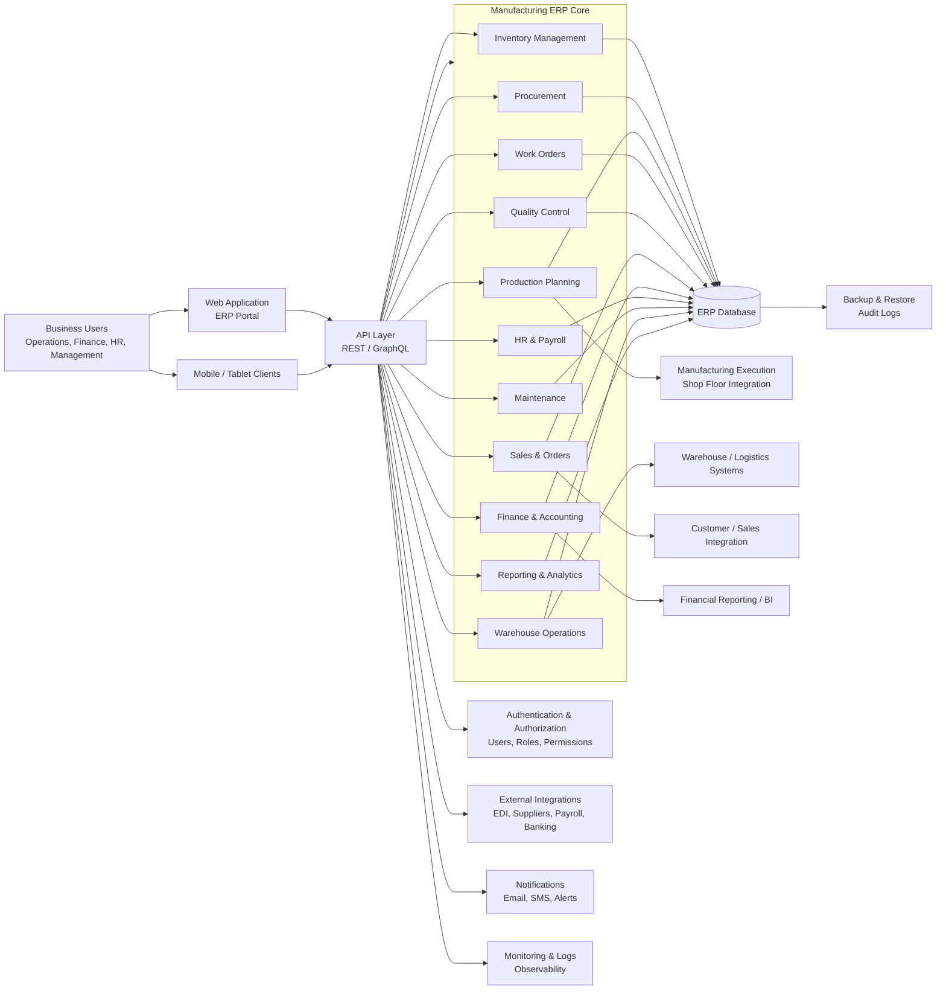

# Manufacturing ERP Architecture Overview

This document provides a high-level architecture overview for a manufacturing ERP system, covering the core business domains typically supported by an ERP solution for production operations.

## Architectural Notes

- The frontend delivers business workflows to users across operations, management, and finance.
- The API layer centralizes business rules, validation, and access control.
- ERP modules share a common transactional database to keep inventory, production, finance, and procurement data consistent.
- External systems such as warehouse tools, supplier portals, and banking systems can integrate through APIs or scheduled synchronization.
- Reporting and analytics serve operational dashboards and executive insights.

## Suggested Domain Breakdown

- Inventory and Materials
- Production Planning and Scheduling
- Work Orders and Shop Floor Control
- Procurement and Supplier Management
- Quality and Compliance
- Sales and Customer Orders
- Accounting and Costing
- Human Resources and Payroll
- Asset Maintenance
- Reporting and Business Intelligence
